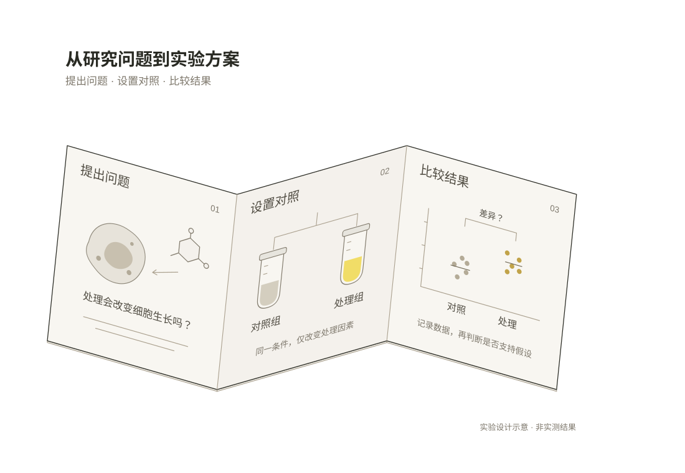

# Visual and motion references

Render these local assets before drawing. They capture the reviewed thin-sheet style without requiring the original presentation or conversation.

## Citation and source

[Editable SVG](../assets/citation-trace.svg). Thin cards share a projected folder structure. The matching 01 markers connect an answer citation to its source. This is a visual reference, not a required folder template for every concept.

## Research question to experiment plan

[Editable SVG](../assets/experiment-plan.svg). A continuous folded sheet carries three different diagrams: a research question, control/treatment groups, and a schematic comparison. The local planes differ while fold vertices coincide. Data points are illustrative, not experimental results.

[Open the offline animation](../assets/experiment-plan-motion.html) by downloading the HTML and opening it in a browser. It has no network dependencies. Autoplay follows the three steps; hover or keyboard focus inspects a fixed region, and exit resumes the saved playhead. Tab moves between regions and Escape releases focus. Reduced motion holds the overview and changes only the annotation. The dynamic arrow preserves clearance throughout its path.

The example is a complete standalone figure. When embedding into slides, connect playback to the host slide's actual visibility event; CSS opacity alone is not a visibility signal. Its narrowly scoped `window.__motionTest` interface exists for deterministic verification, not as a public component API. Remove or namespace that interface when combining figures. Its loop duration and amplitudes are examples; the playback behavior in [playback.md](playback.md) is the reusable contract.

## Release checks

Before publishing revisions, validate all relative links and SVG syntax and compare the token snapshot with the design system source. Run the offline HTML in a browser and check the start, each step, both sides of the loop seam, hover retargeting, interrupted return, focus navigation, hidden-tab pause, offscreen re-entry and reduced motion. Inspect small placement sizes as well as the full canvas. Sample the whole motion path when checking connector clearance, including interaction transitions.

The packaged example was checked in Chromium and desktop Chrome on macOS, including real background-tab pause/resume and keyboard navigation. Other browsers and new concepts still need their own visual review; the bundled example is not a guarantee of correct geometry for a newly generated scene.
